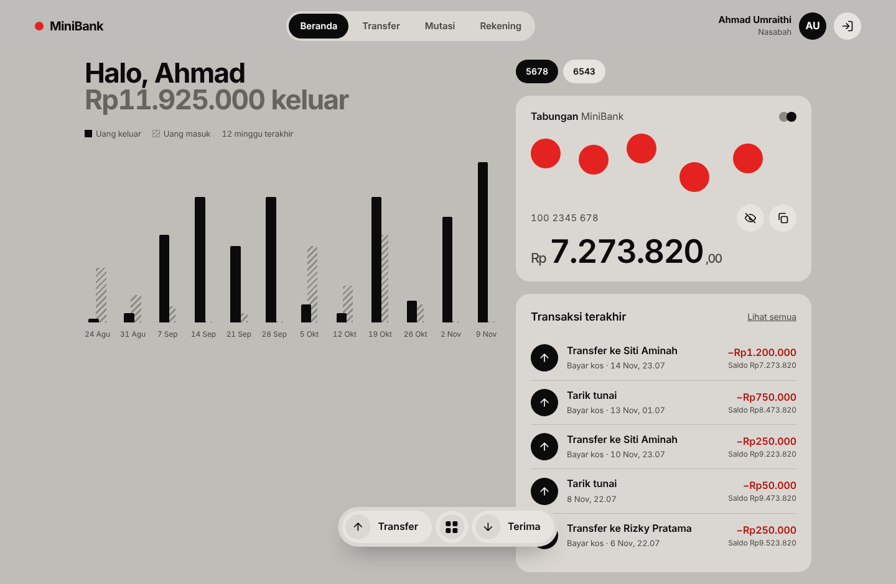
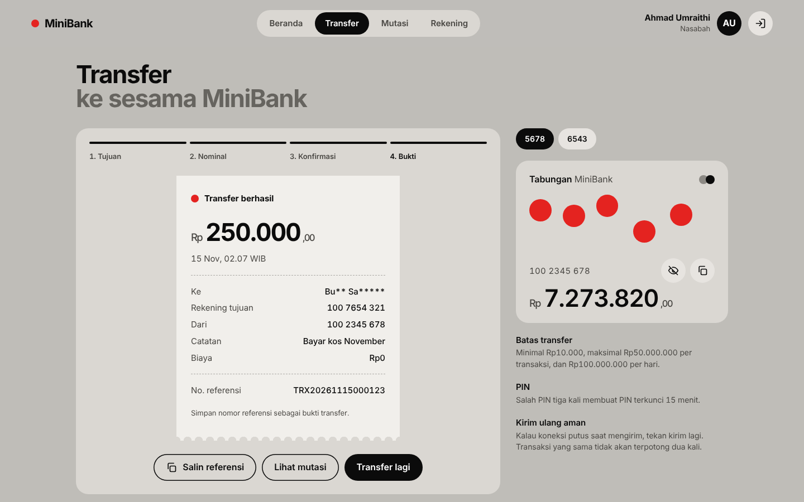
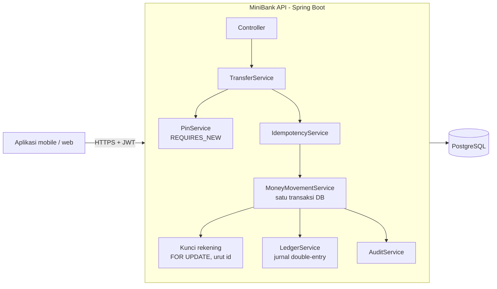
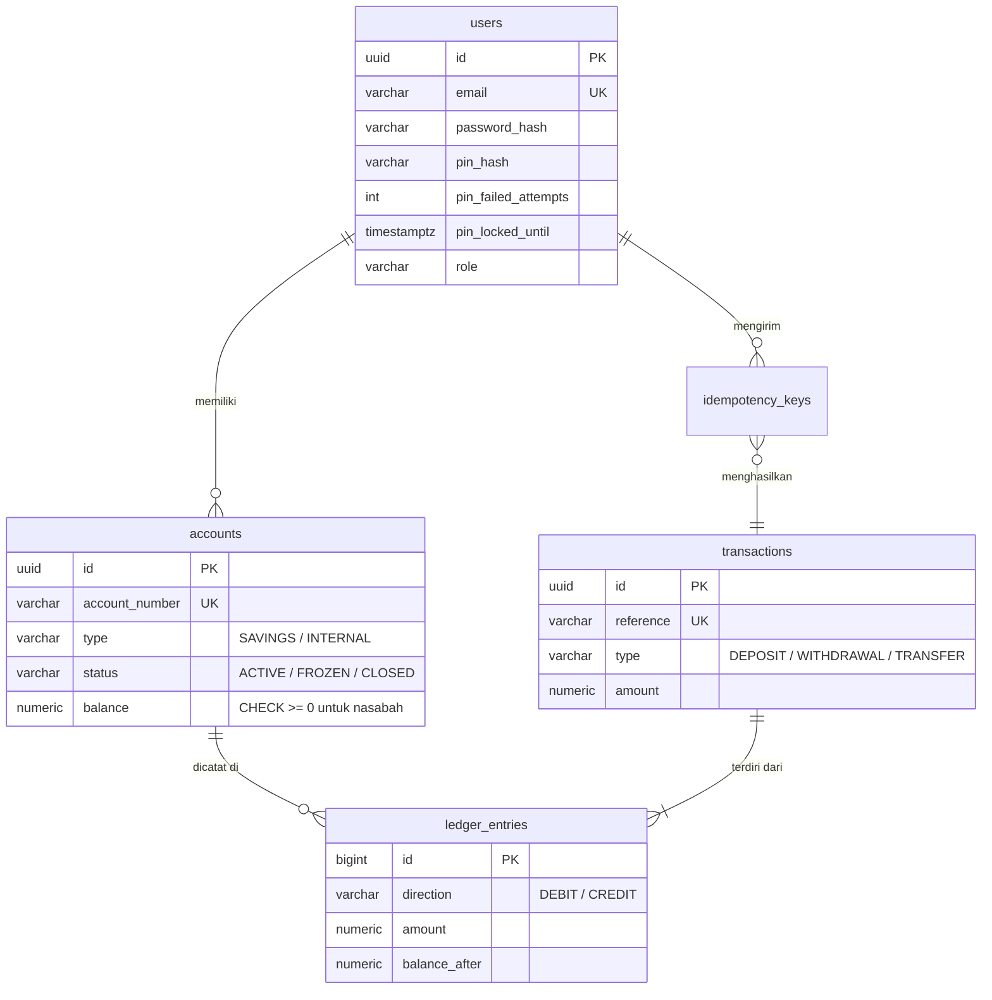

# MiniBank API

[](https://github.com/KADAFERHIDUP/minibank/actions/workflows/ci.yml)

Backend core banking sederhana: nasabah bisa daftar, buka rekening, cek nama penerima, transfer pakai PIN, dan melihat mutasi. Teller bisa setor dan tarik tunai, membekukan rekening, melihat jejak audit, dan menjalankan rekonsiliasi buku besar.

Fokus proyek ini bukan jumlah fitur, tapi **kebenaran data uang**: saldo tidak boleh minus, uang tidak boleh hilang atau tercipta, dan permintaan yang terkirim dua kali tidak boleh memotong saldo dua kali, termasuk saat ada banyak permintaan di detik yang sama.

Ada juga tampilan web internet banking di `http://localhost:8080/`, ditulis tanpa framework (HTML, CSS, JavaScript biasa) dan disajikan langsung oleh Spring Boot.



**Stack:** Java 21 · Spring Boot 3.5 · Spring Security (JWT) · Spring Data JPA · PostgreSQL 16 · Flyway · springdoc OpenAPI · JUnit 5 · Testcontainers · Docker · GitHub Actions

---

## Keputusan desain

| Masalah di sistem bank | Solusinya di MiniBank |
|---|---|
| Uang "hilang" kalau proses gagal di tengah | Debit, kredit, jurnal, dan audit ditulis dalam **satu transaksi database**. Gagal satu langkah, semua dibatalkan. |
| Saldo tidak bisa ditelusuri asalnya | **Pembukuan double-entry**: tiap transaksi punya satu baris DEBIT dan satu baris KREDIT di `ledger_entries` dengan nominal sama. Saldo rekening hanya cache dan bisa dihitung ulang dari buku besar. |
| Dua transfer bersamaan membuat saldo minus | Rekening dikunci dengan `SELECT ... FOR UPDATE` sebelum dicek dan diubah. Database juga punya `CHECK (balance >= 0)` sebagai pengaman terakhir. |
| Deadlock saat A transfer ke B bersamaan B ke A | Rekening selalu dikunci **dalam urutan id yang sama**, jadi tidak ada siklus saling tunggu. |
| Tombol "Kirim" kepencet dua kali, atau jaringan putus lalu aplikasi mengulang | Header **`Idempotency-Key`** wajib. Kunci diklaim lewat unique constraint di dalam transaksi yang sama; permintaan kembar mendapat hasil transaksi pertama (`200`, `Idempotent-Replayed: true`) tanpa memotong saldo lagi. Kunci yang sama dengan isi berbeda ditolak. |
| Saldo dibaca sebelum dikunci (lost update) | Nomor rekening diterjemahkan ke id lewat query skalar, entitas baru dimuat **setelah** baris dikunci, jadi saldo yang dihitung selalu yang terbaru. |
| PIN ditebak berkali-kali | Salah 3 kali → PIN terkunci 15 menit. Hitungan salah disimpan di transaksi terpisah (`REQUIRES_NEW`) supaya tetap tercatat walau transfernya ditolak. PIN lemah seperti `123456` ditolak saat daftar. |
| Brute force login, dan menebak email terdaftar | Login gagal dibatasi per email, dan pesan error serta waktu respons dibuat sama untuk email terdaftar maupun tidak (dicek dengan hash BCrypt pembanding). |
| Melihat atau memakai rekening orang lain | Rekening milik orang lain dijawab `404`, sama dengan rekening yang tidak ada, supaya nomor rekening tidak bisa ditebak lewat API. |
| Salah ketik nomor rekening tujuan | Nomor rekening 10 digit memakai **digit pemeriksa Luhn**, jadi salah ketik satu angka langsung tertolak. Ada juga endpoint cek nama penerima yang menyamarkan nama (`Ah*** Um******`). |
| Bukti kalau datanya benar | Endpoint **rekonsiliasi** memeriksa total debit = total kredit, tiap transaksi seimbang, dan saldo tiap rekening sama dengan hasil hitung ulang buku besar. |
| Siapa melakukan apa | Tabel `audit_logs` mencatat register, login (berhasil/gagal), PIN salah/terkunci, transfer, setor, tarik, bekukan, dan aktifkan rekening beserta IP. |

## Tampilan web

Satu halaman di `src/main/resources/static/` yang memanggil API yang sama dengan Swagger. Isinya:

- **Masuk / buka rekening** dengan pesan galat per kolom dari respons `fields` API.
- **Beranda**: grafik uang keluar dan masuk 12 minggu dari mutasi, kartu rekening dengan tombol sembunyikan saldo dan salin nomor, transaksi terakhir, dan dock aksi cepat (Transfer, Mutasi, Terima).
- **Transfer** empat langkah: cek nama penerima, nominal, konfirmasi dengan PIN, lalu struk. Satu niat transfer memakai satu `Idempotency-Key`, jadi kalau koneksi putus lalu ditekan kirim lagi, saldo tetap terpotong sekali.
- **Mutasi** dengan filter tanggal (maks. 90 hari) dan ringkasan masuk/keluar.
- **Rekening**: daftar rekening, buka rekening baru, profil.
- **Meja teller** (akun admin): setor dan tarik tunai, cari dan bekukan rekening, jejak audit, dan lampu status rekonsiliasi buku besar.

Token disimpan di `sessionStorage`, jadi hilang saat tab ditutup. Respons 401 langsung mengeluarkan pengguna. Tampilan menyesuaikan layar HP (menu pindah ke bawah) dan menghormati pengaturan kurangi animasi.



## Arsitektur



Alur satu transfer:

1. Verifikasi PIN (transaksi DB sendiri, supaya hitungan PIN salah tetap tersimpan).
2. Kalau `Idempotency-Key` sudah pernah dipakai, kembalikan hasil lama.
3. Mulai transaksi DB → klaim kunci idempotensi → kunci kedua rekening → cek kepemilikan, status, limit per transaksi, limit harian, dan saldo → tulis transaksi + 2 baris buku besar → ubah saldo → catat audit → commit.

## Model data



Rekening `INTERNAL` (`9000000001`) adalah kas bank: lawan pembukuan untuk setor dan tarik tunai. Saldo kas boleh minus karena mewakili uang tunai yang masuk ke laci teller.

## Endpoint

Dokumentasi interaktif tersedia di `/swagger-ui.html` setelah aplikasi berjalan.

| Method | Path | Akses | Keterangan |
|---|---|---|---|
| POST | `/api/auth/register` | publik | Daftar, langsung dibukakan rekening tabungan |
| POST | `/api/auth/login` | publik | Mendapat access token JWT (30 menit) |
| GET | `/api/me` | nasabah | Profil |
| GET | `/api/accounts` | nasabah | Daftar rekening saya |
| POST | `/api/accounts` | nasabah | Buka rekening tambahan (maks. 3) |
| GET | `/api/accounts/{nomor}` | pemilik | Detail dan saldo |
| GET | `/api/accounts/{nomor}/inquiry` | nasabah | Cek nama pemilik rekening tujuan |
| GET | `/api/accounts/{nomor}/statement?from=&to=&page=&size=` | pemilik | Mutasi (maks. 90 hari) |
| POST | `/api/transfers` | nasabah | Transfer, wajib `Idempotency-Key` dan PIN |
| GET | `/api/transactions/{referensi}` | pihak terkait | Detail transaksi |
| POST | `/api/admin/deposits` | admin | Setor tunai, wajib `Idempotency-Key` |
| POST | `/api/admin/withdrawals` | admin | Tarik tunai, wajib `Idempotency-Key` |
| GET | `/api/admin/accounts/{nomor}` | admin | Detail rekening + data pemilik |
| POST | `/api/admin/accounts/{nomor}/freeze` | admin | Bekukan rekening |
| POST | `/api/admin/accounts/{nomor}/unfreeze` | admin | Aktifkan kembali |
| GET | `/api/admin/audit-logs` | admin | Jejak audit |
| GET | `/api/admin/ledger/verify` | admin | Rekonsiliasi buku besar |

### Aturan bawaan

Bisa diubah di `application.yml` bagian `minibank`.

| Aturan | Nilai |
|---|---|
| Minimal transfer | Rp10.000 |
| Maksimal per transaksi | Rp50.000.000 |
| Limit transfer harian per rekening | Rp100.000.000 (hari dihitung zona Asia/Jakarta) |
| PIN salah sebelum terkunci | 3 kali, terkunci 15 menit |
| Login gagal sebelum ditahan | 5 kali dalam 15 menit |

### Format error

Semua error memakai [RFC 7807](https://www.rfc-editor.org/rfc/rfc7807) (`application/problem+json`) dengan field `code` yang stabil, supaya aplikasi bisa menampilkan pesan yang tepat:

```json
{
  "type": "https://minibank.dev/errors/insufficient-balance",
  "title": "Unprocessable Entity",
  "status": 422,
  "detail": "Saldo tidak cukup",
  "code": "INSUFFICIENT_BALANCE"
}
```

Kode yang dipakai antara lain `VALIDATION_FAILED`, `IDEMPOTENCY_KEY_REQUIRED`, `IDEMPOTENCY_KEY_REUSED`, `INVALID_CREDENTIALS`, `TOO_MANY_ATTEMPTS`, `INVALID_PIN`, `PIN_LOCKED`, `WEAK_PIN`, `INSUFFICIENT_BALANCE`, `LIMIT_EXCEEDED`, `DAILY_LIMIT_EXCEEDED`, `ACCOUNT_NOT_ACTIVE`, `DESTINATION_INVALID`, `ACCOUNT_NOT_FOUND`. Daftar lengkapnya di `ErrorCode.java`.

## Menjalankan

### Dengan Docker (paling mudah)

```bash
docker compose up --build
```

Tampilan web di `http://localhost:8080/`, Swagger di `http://localhost:8080/swagger-ui.html`. Akun teller untuk lokal: `teller@minibank.local` / `Teller12345` (diatur di `docker-compose.yml`).

### Tanpa Docker

Butuh Java 21 dan PostgreSQL yang punya database `minibank`.

```bash
export JWT_SECRET="isi-dengan-rahasia-acak-minimal-32-karakter"
export ADMIN_EMAIL="teller@minibank.local"
export ADMIN_PASSWORD="Teller12345"
mvn spring-boot:run
```

| Environment variable | Default | Keterangan |
|---|---|---|
| `DB_URL` | `jdbc:postgresql://localhost:5432/minibank` | |
| `DB_USER` / `DB_PASSWORD` | `minibank` / `minibank` | |
| `JWT_SECRET` | wajib | Minimal 32 karakter. Aplikasi menolak jalan kalau kosong. |
| `JWT_TTL` | `30m` | Masa berlaku token |
| `ADMIN_EMAIL` / `ADMIN_PASSWORD` | kosong | Kalau diisi, akun teller dibuat saat start |

### Online: Supabase + Render

Database memakai PostgreSQL di [Supabase](https://supabase.com), aplikasinya di-deploy dari `Dockerfile` ke [Render](https://render.com).

1. Di Supabase, buat project (region Singapore). Dari tombol **Connect**, ambil koneksi **Session pooler** (port 5432, jalan di IPv4).
2. Di Render, buat **Web Service** dari repo ini. Render membaca `Dockerfile` sendiri.
3. Isi environment variable:

| Variable | Isi |
|---|---|
| `DB_URL` | `jdbc:postgresql://<host-pooler>:5432/postgres?sslmode=require` |
| `DB_USER` | `postgres.<project-ref>` |
| `DB_PASSWORD` | password database Supabase |
| `DB_POOL_SIZE` | `5` |
| `JWT_SECRET` | string acak minimal 32 karakter |
| `ADMIN_EMAIL` / `ADMIN_PASSWORD` | akun teller produksi, jangan pakai password contoh |

Flyway membuat tabel saat aplikasi pertama kali jalan. Migrasi `V2` menyalakan RLS di semua tabel MiniBank dan mencabut hak role `anon`/`authenticated`, jadi data tidak bisa dibaca lewat Data API Supabase walaupun anon key bocor. Aplikasi konek sebagai pemilik tabel, jadi tidak terpengaruh.

Paket gratis Render tidur setelah 15 menit tanpa pengunjung, dan butuh sekitar satu menit untuk bangun lagi.

### Coba alurnya dengan curl

```bash
# 1. Daftar dua nasabah
curl -s localhost:8080/api/auth/register -H 'Content-Type: application/json' -d '{
  "fullName":"Ahmad Umraithi","email":"ahmad@contoh.id","phone":"081234567890",
  "password":"Rahasia123","pin":"246810"}'
curl -s localhost:8080/api/auth/register -H 'Content-Type: application/json' -d '{
  "fullName":"Budi Santoso","email":"budi@contoh.id","phone":"081298765432",
  "password":"Rahasia123","pin":"135792"}'
# catat accountNumber masing-masing, misalnya AHMAD=10xxxxxxxx dan BUDI=10yyyyyyyy

# 2. Teller setor tunai ke rekening Ahmad
TELLER=$(curl -s localhost:8080/api/auth/login -H 'Content-Type: application/json' \
  -d '{"email":"teller@minibank.local","password":"Teller12345"}' | jq -r .accessToken)
curl -s localhost:8080/api/admin/deposits -H "Authorization: Bearer $TELLER" \
  -H 'Content-Type: application/json' -H "Idempotency-Key: $(uuidgen)" \
  -d "{\"accountNumber\":\"$AHMAD\",\"amount\":500000}"

# 3. Ahmad cek nama penerima lalu transfer
TOKEN=$(curl -s localhost:8080/api/auth/login -H 'Content-Type: application/json' \
  -d '{"email":"ahmad@contoh.id","password":"Rahasia123"}' | jq -r .accessToken)
curl -s localhost:8080/api/accounts/$BUDI/inquiry -H "Authorization: Bearer $TOKEN"
KEY=$(uuidgen)
curl -si localhost:8080/api/transfers -H "Authorization: Bearer $TOKEN" \
  -H 'Content-Type: application/json' -H "Idempotency-Key: $KEY" \
  -d "{\"fromAccount\":\"$AHMAD\",\"toAccount\":\"$BUDI\",\"amount\":125000,\"description\":\"Bayar kos\",\"pin\":\"246810\"}"

# 4. Kirim ulang dengan kunci yang sama: hasilnya sama, saldo tidak terpotong dua kali
curl -si localhost:8080/api/transfers -H "Authorization: Bearer $TOKEN" \
  -H 'Content-Type: application/json' -H "Idempotency-Key: $KEY" \
  -d "{\"fromAccount\":\"$AHMAD\",\"toAccount\":\"$BUDI\",\"amount\":125000,\"description\":\"Bayar kos\",\"pin\":\"246810\"}"

# 5. Mutasi dan rekonsiliasi
curl -s localhost:8080/api/accounts/$AHMAD/statement -H "Authorization: Bearer $TOKEN"
curl -s localhost:8080/api/admin/ledger/verify -H "Authorization: Bearer $TELLER"
```

## Testing

```bash
mvn verify   # butuh Docker untuk Testcontainers
```

Test integrasi menjalankan aplikasi penuh dengan PostgreSQL asli di Docker, bukan database tiruan. Skenario yang diuji antara lain:

- **20 transfer @Rp10.000 ditembak bersamaan** dari saldo Rp100.000 → tepat 10 berhasil, 10 ditolak, saldo akhir 0, buku besar seimbang.
- **10 permintaan dengan `Idempotency-Key` yang sama** dikirim bersamaan → hanya 1 transaksi tercipta, semua respons membawa nomor referensi yang sama.
- **A→B dan B→A bersamaan** sebanyak 20 kali → tidak ada deadlock, saldo akhir kembali seperti semula.
- Saldo kurang, limit per transaksi, limit harian, rekening sama, rekening tujuan tidak valid.
- PIN salah 3x lalu terkunci, dan PIN benar tetap ditolak selama terkunci.
- Rekening dibekukan tidak bisa mengirim atau menerima, lalu bisa lagi setelah diaktifkan.
- Nasabah tidak bisa melihat, memakai, atau menebak rekening orang lain, dan tidak bisa mengakses endpoint admin.
- Validasi pendaftaran, email ganda, pembatasan login gagal, dan rekonsiliasi buku besar.

Unit test menguji generator nomor rekening (digit Luhn mendeteksi salah ketik), pembulatan nominal, dan penyamaran nama. Semua test jalan otomatis di GitHub Actions setiap push.

## Struktur proyek

```
src/main/java/io/github/kadaferhidup/minibank
├── account/    rekening, nomor rekening Luhn, mutasi, cek nama penerima
├── admin/      endpoint teller: setor, tarik, bekukan, audit, rekonsiliasi
├── audit/      jejak audit
├── auth/       register, login JWT, PIN, pembatas login gagal
├── common/     format error RFC 7807, utilitas uang dan penyamaran
├── config/     security, properti aturan bank, OpenAPI, akun admin awal
├── ledger/     transaksi, buku besar double-entry, rekonsiliasi
├── transfer/   transfer, idempotency key, inti perpindahan uang
└── user/       entitas pengguna
src/main/resources/db/migration   skema database (Flyway)
```

## Batasan dan langkah berikutnya

Proyek ini dibuat untuk belajar dan portofolio, bukan untuk dipakai menyimpan uang sungguhan. Yang akan ditambahkan kalau dikembangkan ke tahap produksi:

- Pembatas login disimpan di Redis supaya berlaku di banyak instance (sekarang di memori).
- Refresh token dan pencabutan token saat logout.
- Kas internal dipecah per cabang atau per teller supaya setor/tarik tidak antre di satu baris kunci.
- Transactional outbox untuk mengirim notifikasi transaksi ke layanan lain.
- Deteksi transaksi mencurigakan (fraud scoring) sebelum transfer dieksekusi.

---

Dibuat oleh **Ahmad Umraithi** · Teknik Informatika, Universitas Malikussaleh
